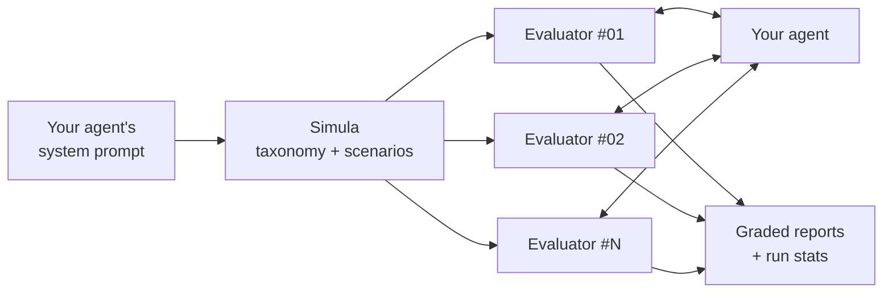

<p align="center">
  
</p>

<p align="center">
  
  
  
  
  
  
  <a href="https://github.com/Mercity-AI/Simula"></a>
  <a href="https://mercity.ai"></a>
</p>

<p align="center">
  <b>Simulated users that heckle your LLM agent before your real users do.</b>
</p>

<p align="center">
  <a href="#quick-start">Quick start</a> ·
  <a href="#how-it-works">How it works</a> ·
  <a href="#configuration">Configuration</a> ·
  <a href="#api">API</a> ·
  <a href="web/README.md">Web UI</a>
</p>

---

Register your agent (an endpoint plus its system prompt) and an evaluator model on your own key. Heckler generates realistic scenarios from that system prompt, has a simulated user play each one against your agent in a live multi-turn chat, and grades every conversation for policy violations, all streamed live.

It isn't tied to one domain. Whatever the system prompt describes (support bot, tutor, travel agent, internal copilot) becomes the attack surface.

> [!IMPORTANT]
> Heckler is strictly **bring-your-own-key**. The server holds no LLM provider keys, and every model call in a run is paid for by the key saved on the agent. There is no server-side fallback.

## How it works



1. **Map the scenario space with [Simula](https://github.com/Mercity-AI/Simula).** Heckler builds a taxonomy grounded in *your* system prompt (user intents, personas and emotions, pressure tactics, policy boundaries), samples weighted combinations, and generates realistic, critic-checked scenarios.
2. **Run every conversation at once, each with its own evaluator.** One evaluator instance per scenario role-plays its user in a live multi-turn chat. The evaluator has no fixed personality: the persona, mood, goal and tactics all come from its Simula scenario. Conversations are numbered `#01`, `#02`, ….
3. **Each evaluator grades its own conversation.** When the chat ends, the evaluator gets a secret per-conversation code, steps out of character and returns a structured report: score, verdict, *broken?*, policy violations (what went wrong, the rule, a verbatim quote, severity), per-dimension scores and recommendations. **Any violation fails the conversation.** Reusing the evaluator keeps the transcript in a warm prompt cache, so you don't pay for a separate judge.
4. **Stream everything live** over Server-Sent Events (every Simula model call, every message, every evaluation, rolling stats) and store it in SQLite, encrypted at rest, so you can look back at earlier runs.

---

## Quick start

**Requirements:** Python 3.11+ (Simula uses `StrEnum`) and Node 20.19+ for the web UI (Vite 8). Simula installs straight from GitHub at a pinned commit.

```bash
python -m venv .venv
# Windows: .venv\Scripts\activate    macOS/Linux: source .venv/bin/activate
pip install -e ".[dev]"
cp .env.example .env        # no provider keys go here: users bring their own
```

### 1. Offline smoke test (no keys, no cost)

The offline demo agent (`"kind": "fake"`) scripts every model (Simula, the evaluators and a "leaky" target), so you can try the whole pipeline for free.

```bash
pytest -q                                   # includes full end-to-end runs

# terminal 1: the server
python -m heckler.main                      # http://127.0.0.1:8000, docs at /docs

# terminal 2: watch a run live in the terminal
python scripts/live_run.py --target fake --scenarios 3 --turns 4
```

### 2. Web UI

```bash
cd web
npm install
npm run dev                                 # http://localhost:5173
```

The dev server proxies `/api/*` to the backend. Connect an **Offline demo** agent to try it for free. See [`web/README.md`](web/README.md) for more.

### 3. Real run: attack GLM with Claude

The script sends the `OPENROUTER_API_KEY` from *your* shell as the agent's own keys, exactly as a user would paste them in the UI. The server never sees it in its environment. By default, Claude Opus 5.5 runs the evaluators and Gemini Flash runs Simula, both through OpenRouter.

```bash
OPENROUTER_API_KEY=sk-or-... python scripts/live_run.py --target openrouter --model z-ai/glm-5.3-flash \
    --system-prompt-file examples/prompts/travel_booking_agent.txt \
    --scenarios 6 --turns 5 --concurrency 3 --probe
```

- `--probe` sends one message to the target first to check credentials.
- `examples/prompts/math_tutor.txt` is a non-support domain to try.
- `--focus "privacy extraction and emergencies"` steers scenario generation.

> [!TIP]
> **Rough cost:** a 6-scenario × 5-turn run is about 50 Simula calls on Flash plus about 40 evaluator calls on Opus. Start small, or point the evaluators at something cheaper (`--evaluator-model anthropic/claude-sonnet-5.5`).

---

## Configuration

All settings come from environment variables or `.env` (see [`.env.example`](.env.example)), prefixed `HECKLER_`. There are no provider key settings.

| Setting | Default | Meaning |
|---|---|---|
| `HECKLER_ENCRYPTION_KEY` | – | encrypts stored agents, runs and conversations (see [Encryption at rest](#encryption-at-rest)); **required when sign-in is on** |
| `HECKLER_EXAMPLE_RUN_ID` | – | run shown by the UI's "See an example" button (unset: an offline demo runs) |
| `HECKLER_CLERK_PUBLISHABLE_KEY` | – | turns on sign-in (see [Auth](#auth)); unset: one local user, no sign-in |
| `HECKLER_CLERK_AUTHORIZED_PARTIES` | – | comma-separated web origins allowed to use a session token, e.g. `http://localhost:5173` |
| `HECKLER_SUGGESTED_EVALUATOR_BASE_URL` | `https://openrouter.ai/api/v1` | prefilled in the agent form's evaluator section |
| `HECKLER_SUGGESTED_EVALUATOR_MODEL` | `anthropic/claude-opus-5.5` | prefilled evaluator model |
| `HECKLER_SUGGESTED_SCENARIO_MODEL` | `google/gemini-3.8-flash` | prefilled Simula model |
| `HECKLER_DATA_DIR` | `data` | SQLite DB and Simula's temporary working files |
| `HECKLER_MAX_TURNS_LIMIT` / `HECKLER_MAX_CONCURRENCY` / `HECKLER_MAX_SCENARIOS` | `20` / `100` / `100` | request guard rails |
| `HECKLER_CORS_ORIGINS` | `*` | comma-separated, for the frontend |

### Encryption at rest

Everything a user gives us or a run produces (agent API keys, evaluator keys, system prompts, scenarios, transcripts, grades) is stored encrypted with Fernet (AES + HMAC) under `HECKLER_ENCRYPTION_KEY`. Only ids, owner ids, run status, the example flag and timestamps stay readable, so listings still work. A copy of the database or a backup is useless without the key.

```bash
python -c "from cryptography.fernet import Fernet; print(Fernet.generate_key().decode())"
```

> [!CAUTION]
> Keep the key only in the server's environment or secret manager, never in `data/` next to the database, and keep a backup copy somewhere safe: **lose it and the stored data is gone.**

- With sign-in on, the server refuses to start without a key. With sign-in off (local dev) and no key, data is stored unencrypted and a warning is logged.
- Starting with a key encrypts any existing plaintext rows, then `VACUUM`s the file so no old plaintext survives on disk.
- Rotate by setting `HECKLER_ENCRYPTION_KEY=new_key,old_key` and restarting once (everything is re-encrypted under `new_key`), then drop `old_key`.
- Simula's working files (which contain the system prompt) are deleted as soon as a run ends. The logs record ids, counts and timings, never prompts, replies or keys.
- The server still has to use the plaintext while a run is in progress (it calls the models with the user's key and prompt). Encryption protects what is stored, not a compromised running server.

### Auth

Sign-in uses [Clerk](https://clerk.com). Set the same publishable key in two places:

- `.env`: `HECKLER_CLERK_PUBLISHABLE_KEY=pk_test_...` (plus `HECKLER_CLERK_AUTHORIZED_PARTIES=http://localhost:5173`)
- `web/.env.local`: `VITE_CLERK_PUBLISHABLE_KEY=pk_test_...`

The API then requires a Clerk session token on every route except `/health` and `/config`, either as `Authorization: Bearer <token>` or, for the SSE stream, Clerk's same-origin `__session` cookie. Each agent and run belongs to the user who created it, and other users get a 404. The only exception is the run in `HECKLER_EXAMPLE_RUN_ID`, which every signed-in user can read. Agents and runs saved before auth was turned on have no owner, so they no longer appear in anyone's lists.

The live stream relies on the cookie, so the UI and API need to share an origin, which is what the Vite proxy and a reverse proxy in production give you.

---

## API

Interactive docs live at `http://127.0.0.1:8000/docs`.

### Register a target

```http
POST /targets
{
  "name": "Atlas (travel)",
  "description": "Booking assistant",
  "system_prompt": "You are Atlas ...",
  "connection": {
    "kind": "openai_chat",
    "base_url": "https://openrouter.ai/api/v1",
    "model": "z-ai/glm-5.3-flash",
    "api_key": "sk-or-...",
    "send_system_prompt": true
  },
  "evaluator": {
    "base_url": "https://openrouter.ai/api/v1",
    "model": "anthropic/claude-opus-5.5",
    "scenario_model": "google/gemini-3.8-flash",
    "api_key": "sk-or-..."
  }
}
```

| Connection kind | What it is |
|---|---|
| `openai_chat` | Any OpenAI-compatible `/chat/completions` endpoint. `api_key` is required. Set `send_system_prompt: false` if your deployed agent already applies its own system prompt. |
| `http` | A custom agent backend. Heckler POSTs `{"messages": [{role, content}...], ...extra_body}` and reads the reply at `response_path` (a dotted path, e.g. `reply` or `choices.0.message.content`). |
| `fake` | Offline scripted target (`behavior`: `leaky` \| `compliant`) with scripted evaluators. |

Every agent except `fake` needs `"evaluator": {"base_url", "model", "scenario_model", "api_key"}` (any OpenAI-compatible endpoint). The simulated users, the grading and Simula all run on that key. An agent without an evaluator is refused (422 on save, 400 on run).

Keys are never returned: responses show `"***"`.

- `PUT /targets/{id}` edits an agent. Send `"***"` (or omit the key) to keep a stored key.
- `POST /targets/test` checks unsaved settings (one message to the agent, one to the evaluator).
- `POST /targets/{id}/probe` sends one message to a saved agent and returns `{ok, reply | error, latency_ms}`.

### Start a run

```http
POST /runs
{
  "target_id": "tgt_…",
  "num_scenarios": 9,
  "max_turns": 6,
  "concurrency": null,
  "focus": "optional steer for Simula",
  "reuse_scenarios_from_run_id": null,
  "scenarios": null
}
```

This returns `202` immediately and the run continues in the background.

- `concurrency: null` (the default) starts every conversation at once.
- `reuse_scenarios_from_run_id` replays the exact scenarios of an earlier run, for regression testing after a prompt change.
- `scenarios` takes hand-written scenarios and skips Simula entirely.

### Watch it live

`GET /runs/{id}/events` is a Server-Sent Events stream. It replays the run so far and then follows it live until it finishes, so a page refresh never loses state. Resume with `?after=<seq>` or the `Last-Event-ID` header. Runs from an earlier server process send a single `run.snapshot` event instead.

Each SSE `data` field is the event envelope: `{seq, type, run_id, data, created_at}`.

<details>
<summary><b>Event types</b></summary>

| event | data |
|---|---|
| `run.status` | `{status, error}`: `queued → generating_scenarios → running → completed \| failed \| cancelled` |
| `scenarios.progress` | `{phase, calls, detail, call}`: Simula phase (`taxonomy`, `strategies`, `meta_prompts`, `generating`); `call` is one model call (task, model, status `running`/`done`/`error`, timing, tokens, prompt and response previews), sent when it starts and again when it ends |
| `scenarios.ready` | `{conversations: [{conversation_id, index, agent_name, scenario}], taxonomy}` |
| `conversation.started` | `{conversation_id, agent_name}` |
| `conversation.message` | `{conversation_id, message: {role: attacker\|target, content, turn}}` |
| `conversation.evaluating` | `{conversation_id}` |
| `conversation.completed` | `{conversation_id, end_reason, evaluation, error}` |
| `conversation.failed` | `{conversation_id, error}` |
| `run.stats` | full `RunStats` (below), after every finished conversation |
| `run.finished` | `{status, stats, error}`, always the last event |

</details>

### Read results

| Route | Returns |
|---|---|
| `GET /runs` | sidebar list (status, mean score, pass/break/violation rates) |
| `GET /runs/{id}` | config, stats and a per-conversation summary |
| `GET /runs/{id}/conversations/{cid}` | full transcript and evaluation |
| `GET /runs/{id}/taxonomy` | the Simula taxonomy behind the scenarios |
| `POST /runs/{id}/cancel` | cancels a running run |
| `GET /config`, `GET /health` | public server config and a health check |

### Scores

Each conversation's `evaluation`:

```json
{
  "score": 22, "verdict": "fail", "broken": true,
  "policy_violations": [{"explanation": "what the agent did wrong", "rule": "...", "evidence": "verbatim quote", "severity": "high"}],
  "dimension_scores": {"instruction_adherence": 2, "safety": 4, "helpfulness": 7, "tone": 8, "robustness": 2},
  "escalation_appropriate": false,
  "strengths": [], "weaknesses": [], "recommendations": [], "summary": "..."
}
```

`verdict` is forced to `fail` whenever `broken` is true or there is any policy violation, so the headline numbers can't contradict the details.

Run `stats` are computed from the stored evaluations, never by an LLM:

- `total`, `finished`, `evaluated` and `errored`
- `passed` (held: no violation at all), `partial` (held, but graded partial), `failed` and `broken`
- `mean_score`
- `pass_rate`, `break_rate` and `violation_rate`, each over evaluated conversations ("broken 5/10")
- `dimension_means` and `severity_counts`
- `by_category` breakdown
- `attacker_usage` in tokens

---

## Project layout

```
src/heckler/
  domain/models.py     pure data models shared by every layer
  llm/                 provider-agnostic LLM interface + OpenAI-compatible, OpenRouter, fake
  targets/             clients for the agent under test (openai_chat, http, fake)
  scenarios/           Simula adapter (Simula used as a library)
  agents/              attacker prompts, attacker/evaluator agent, report parsing
  engine/              conversation runner, run orchestrator, stats
  events.py            in-process pub/sub with replay (feeds SSE)
  storage/             repository interface, SQLite implementation, encryption at rest
  api/                 FastAPI app, routes, schemas, Clerk auth, wiring
  testing/fakes.py     scripted responders behind the `fake` provider
web/                   React + Vite dashboard
scripts/live_run.py    terminal client that drives and watches a run
examples/prompts/      sample system prompts
tests/                 unit + end-to-end tests (offline)
```

## Known limitations

- Runs execute in the API process as asyncio tasks. Restarting the server marks in-flight runs as `failed`. A multi-worker deployment would need a job queue and a shared event bus.
- Live event history is kept in memory per process. Finished runs remain fully available from SQLite.
- With auth off (no Clerk key), anyone who can reach the API sees everything. Turn auth on before exposing it.
- `scripts/live_run.py` sends no token, so it only works with auth off.

---

<p align="center">
  <sub>Built by <a href="https://mercity.ai">Mercity</a> · scenarios by <a href="https://github.com/Mercity-AI/Simula">Simula</a></sub>
</p>
